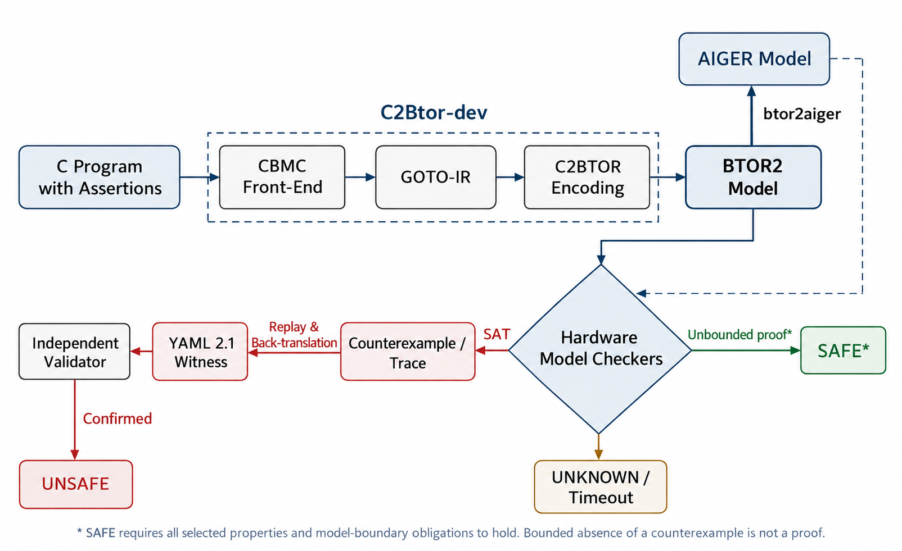

# C2BTOR

简体中文 | [English](README.en.md)

C2Btor 是一款 C 语言程序验证工具。它将 C 程序转换为硬件模型检查格式 BTOR2，将程序断言的验证转化为可达性检查。支持 Carat、rIC3、Pono 2.0、AVR、ABC 等模型检查后端，并可为 Unsafe 程序生成支持 SV-COMP YAML 2.1 标准的 violation witness。



## 依赖

- C++17 编译器和 C 预处理器，例如 GCC/G++
- CMake 3.16+
- CMake
- Flex、Bison、Git、Perl 和 patch


## 编译

```sh
# 配置：在 build 目录生成构建文件
cmake -S . -B build

# 编译 C2BTOR 及其依赖
cmake --build build --target c2btor -j8

build/bin/c2btor --version
```


## BTOR2 建模

```sh
build/bin/c2btor program.c --goto-btor2 --inline --32 \
  --array array --goto-btor2-out model.btor2
```

输入程序应含断言或错误函数调用。

| 参数                                   | 用途                                       |
| -------------------------------------- | ------------------------------------------ |
| `--goto-btor2`                       | 转换为 BTOR2                               |
| `--goto-btor2-out FILE`              | BTOR2 模型输出路径                         |
| `--goto-btor2-map-out FILE`          | witness 回译所需的源代码映射，使用独立文件 |
| `--32` / `--64`                    | C 目标数据模型：ILP32 / LP64               |
| `--inline`                           | 内联普通函数调用                           |
| `--array bv` / `array` / `mixed` | 存储表示；Array/Mixed 需要支持数组的后端   |

完整参数见 `build/bin/c2btor --help`。

## 模型检查后端
- Carat: [Carat](https://github.com/youyusama/Carat) 原版不包含 C2BTOR 的 witness 扩展。
  
  ```sh
  carat -a ic3 model.btor2
  ```
  
  需要 witness 时，使用 `checkers/carat` 中的子模块：
  
  ```sh
  git submodule update --init checkers/carat
  ```
  
  按 [witness 版 Carat 构建说明](https://github.com/westtide/carat-witness#build) 完成编译后运行：
  
  ```sh
  mkdir -p witness-out
  checkers/carat/build/carat -a ic3 -w witness-out/ model.btor2
  ```
  
   [c2btor-verify](c2btor-verify)

- rIC3: [rIC3 仓库](https://github.com/gipsyh/rIC3)，不支持 Array sort，尚未支持 rIC3 的 violation witness 回译：

  ```sh
  ric3 check model.btor2 portfolio
  ```

- Pono 2.0: [Pono 仓库](https://github.com/stanford-centaur/pono)。使用 Bitwuzla 和 IC3SA：
  
  ```sh
  pono --smt-solver bzla -e ic3sa -k 2000000000 model.btor2
  ```

- AVR: [AVR 仓库](https://github.com/aman-goel/avr)，仅支持 BTOR2。在 AVR 目录运行，替换为模型的绝对路径：
  
  ```sh
  python3 avr.py -o output -n example /absolute/path/model.btor2
  ```

- ABC: [ABC 仓库](https://github.com/berkeley-abc/abc)，仅支持 AIGER。先用 [Btor2Tools](https://github.com/hwmcc/btor2tools) 的 `btor2aiger` 将纯 BV 模型转换为 AIGER，再运行 PDR。构建 Btor2Tools 时需启用 `--btor2aiger`。
  
  ```sh
  btor2aiger model.btor2 > model.aig
  abc -c "read_aiger model.aig; pdr"
  ```

## 参考文献

[BTOR2-Based C Program Verification via Hardware Model Checking](https://arxiv.org/abs/2607.17622).

## 许可与致谢

许可证统一存放于 [LICENSES/](LICENSES/)。C2BTOR 自有代码采用 BSD-4-Clause；CBMC 和其他第三方组件保留各自的许可证及声明。

感谢 Daniel Kroening、Edmund Clarke、[CBMC/CProver](https://github.com/diffblue/cbmc)、Carat、[Btor2Tools](https://github.com/hwmcc/btor2tools)、各模型检查器和 witness validator 的作者与维护者。

This product includes software developed by the C2BTOR contributors.

> This product includes software developed by Daniel Kroening,
> Edmund Clarke,
> Computer Science Department, University of Oxford,
> Computer Science Department, Carnegie Mellon University.
